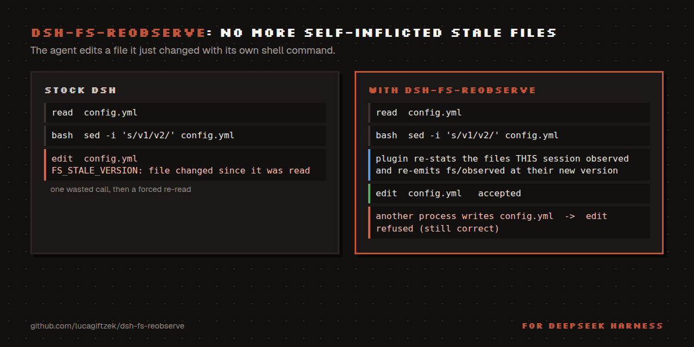

# dsh-fs-reobserve

[](https://www.npmjs.com/package/@lucagiftzek/dsh-fs-reobserve)

Ends self-inflicted stale-file errors after an agent's own shell commands.

```bash
dsh plugin --profile web add @lucagiftzek/dsh-fs-reobserve
# or from GitHub: dsh plugin --profile web add github:lucagiftzek/dsh-fs-reobserve
# then restart dsh web
```



A DSH plugin that supplies the missing middle ground for
`@deepseek-ai/dsh-fs-observation-policy`.

## The problem

The observation policy learns a file's version **only** from instrumented
filesystem operations (`read`, `write` and `edit`), which emit
`fs/observed`. `dsh-tool-bash`, `dsh-shell` and `dsh-subprocess-local`
contain **no reference** to that event. DSH's own documentation:

> Only instrumented filesystem operations report here; the OS is not watched.

So a session that modifies a file through bash leaves a **stale** observation,
and its very next edit of that file is refused with `FS_STALE_VERSION`: an
error caused entirely by the session's own action.

## The three options

| | Strict | **dsh-fs-reobserve** | Disabled |
|---|---|---|---|
| Stale error from your *own* bash writes | fires | **gone** | gone |
| Stale error from a *third-party* writer | fires (correct) | **fires (correct)** | suppressed (unsafe) |
| `FS_NOT_OBSERVED` (read before edit) | enforced | **enforced** | gone |
| Worst-case failure | wasted call | **wasted call** | silent data loss |
| Discipline required | yes | **none** | none |

## What it does

After one of a session's own `bash`/`shell` calls settles, it re-stats the
targets **that session** had observed and re-emits `fs/observed` at their
current state. All three transitions are covered:

- **present → present (new version)**: the command rewrote the file
- **present → absent**: the command deleted the file
- **absent → present**: the command created a file a read had confirmed missing

A version is never manufactured; it comes from `ctx.fs.stat`, the only
sanctioned source.

## What it deliberately does not do

It never re-observes a change the session did not cause. A file rewritten by
cron, another agent, or a desktop editor keeps its old observation, so the next
edit still fails with `FS_STALE_VERSION` and the agent is still forced to
re-read. That is the protection worth keeping.

## Configuration

Options are read from the plugin's loader entry config (the `fs-reobserve` row in your
profile's `cordis.patch.yml`); a `settings.yaml` section is not read. Example in
[docs/TROUBLESHOOTING.md](docs/TROUBLESHOOTING.md#t-tuning-ignored).

| Key | Default | Meaning |
|---|---|---|
| `tools` | `[bash, shell]` | out-of-band tools to react to |
| `notify` | `true` | attach a notice to the tool result so the agent knows |
| `maxNotifyPaths` | `4` | paths named before eliding |

## Install

Install from npm: `dsh plugin --profile web add @lucagiftzek/dsh-fs-reobserve`, or from GitHub: `dsh plugin --profile web add github:lucagiftzek/dsh-fs-reobserve`.

```bash
dsh plugin --profile web add @lucagiftzek/dsh-fs-reobserve
# or from GitHub: dsh plugin --profile web add github:lucagiftzek/dsh-fs-reobserve
# then restart `dsh web`; the log shows "fs-reobserve: armed ..." once
```

A local checkout works the same way: `dsh plugin --profile web add link:/absolute/path/to/dsh-fs-reobserve`.
Requires Node 22.5 or newer and a DSH build that ships `@deepseek-ai/dsh-fs-observation-policy`
(used on DSH 0.1.5 and 0.2.1). Tests: `npm test`.

The package declares `dsh.bundle`, so `dsh plugin add` puts it in `dsh.profile.bundles`
and its own patch inserts the `fs-reobserve` entry. Do not add a second insert row by hand.

## Kill switch without uninstalling

Add to `~/.dsh/profiles/web/cordis.patch.yml`:

```yaml
- id: fs-reobserve
  disabled: true
```

## When something goes wrong

- Ask your agent to load the **`fs-reobserve-doctor`** skill. This version does not register
  it automatically: copy `skills/fs-reobserve-doctor` into `~/.dsh/skills/` once
  ([how](docs/TROUBLESHOOTING.md#skill)).
- Symptom-first guide: [docs/TROUBLESHOOTING.md](docs/TROUBLESHOOTING.md).
- Codes and log lines: [docs/ERRORS.md](docs/ERRORS.md).

---

## More plugins by the same author

All of them are open source and run on DeepSeek Harness 0.2.x (several on 0.1.5 too).

| Plugin | What it does |
|:---|:---|
| [dsh-artifacts](https://github.com/lucagiftzek/dsh-artifacts) | An Artifacts tab that lists the files an agent produced and previews them in place, plus a template library agents can use and extend |
| [dsh-mail](https://github.com/lucagiftzek/dsh-mail) | Mail client and agent mail tools: IMAP, POP3, SMTP and OAuth2 accounts, scheduled and bulk sends with unsubscribe handling |
| [dsh-note-keeper](https://github.com/lucagiftzek/dsh-note-keeper) | Obsidian-compatible Markdown notes in the sidebar with search, graph, audio notes and transcription, OCR and client-side encryption |
| [dsh-phone](https://github.com/lucagiftzek/dsh-phone) | SMS and calls (Twilio, SIP via Asterisk) with call audio through your own server, live voicemail and Telegram |
| [dsh-voice](https://github.com/lucagiftzek/dsh-voice) | Read-aloud, dictation and language-aware speech with 23 TTS and STT providers, per-language routing and word highlighting |
| [dsh-orchestrator](https://github.com/lucagiftzek/dsh-orchestrator) | Agent swarm and task orchestration: an Orchestrate tab, `orch_*` tools, runners, provider cards and a machine API |
| [dsh-workspace-rail](https://github.com/lucagiftzek/dsh-workspace-rail) | A workspace-first sidebar rail: pinned chats, projects as folders, live Recents, search and unread markers |
| [DSH-Idle-Watchdog](https://github.com/lucagiftzek/DSH-Idle-Watchdog) | Idle-chat nudges and an authenticated HTTP API that posts a prompt into any chat |
| [dsh-plugin-updates](https://github.com/lucagiftzek/dsh-plugin-updates) | Update checker that only offers releases your running DSH core can load |
| [dsh-subagent-tiering](https://github.com/lucagiftzek/dsh-subagent-tiering) | Subagents default to a cheaper sibling of the parent model unless the agent names a route |
| [dsh-fs-reobserve](https://github.com/lucagiftzek/dsh-fs-reobserve) (this one) | Ends self-inflicted stale-file errors after an agent's own shell commands |
| [dsh-request-image-cap](https://github.com/lucagiftzek/dsh-request-image-cap) | Clamps every image sent to the model to a pixel cap, fixing many-image request errors |
| [dsh-seal](https://github.com/lucagiftzek/dsh-seal) | An encrypted channel in front of DSH: a Go reverse proxy plus a service worker that seal all DSH browser traffic |

Built by Luca Tzekos, who also makes [**Job Opportunities API**](https://jobopportunitiesapi.org): employer-direct job data with per-field provenance you can verify yourself, free to read and available as an API. If this plugin is useful to you, a star on this repo or a look at [jobopportunitiesapi.org](https://jobopportunitiesapi.org) is the best thanks.
